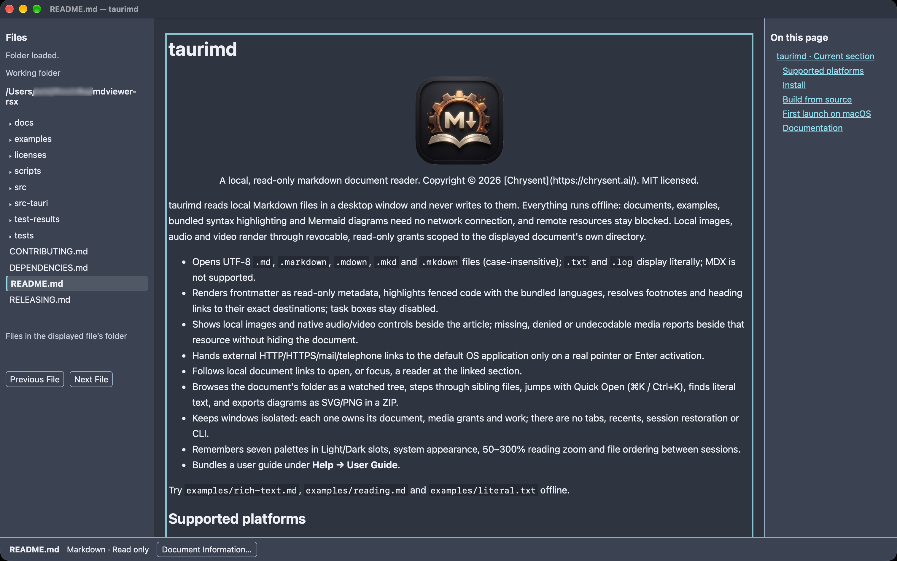

# taurimd

<p align="center">
  
<br>
  A local, read-only markdown document reader. Copyright © 2026 [Chrysent](https://chrysent.ai/). MIT licensed.

</p>

taurimd reads local Markdown files in a desktop window and never writes to them. Everything runs offline: documents, examples, bundled syntax highlighting and Mermaid diagrams need no network connection, and remote resources stay blocked. Local images, audio and video render through revocable, read-only grants scoped to the displayed document's own directory.

- Opens UTF-8 `.md`, `.markdown`, `.mdown`, `.mkd` and `.mkdown` files (case-insensitive); `.txt` and `.log` display literally; MDX is not supported.
- Renders frontmatter as read-only metadata, highlights fenced code with the bundled languages, resolves footnotes and heading links to their exact destinations; task boxes stay disabled.
- Shows local images and native audio/video controls beside the article; missing, denied or undecodable media reports beside that resource without hiding the document.
- Hands external HTTP/HTTPS/mail/telephone links to the default OS application only on a real pointer or Enter activation.
- Follows local document links to open, or focus, a reader at the linked section.
- Browses the document's folder as a watched tree, steps through sibling files, jumps with Quick Open (⌘K / Ctrl+K), finds literal text, and exports diagrams as SVG/PNG in a ZIP.
- Keeps windows isolated: each one owns its document, media grants and work; there are no tabs, recents, session restoration or CLI.
- Remembers seven palettes in Light/Dark slots, system appearance, 50–300% reading zoom and file ordering between sessions.
- Bundles a user guide under **Help → User Guide**.

Try `examples/rich-text.md`, `examples/reading.md` and `examples/literal.txt` offline.

## Screenshot

<p align="center">

</p>

## Supported platforms

macOS 15+ Apple Silicon, Windows 11 x64 with Evergreen WebView2, and Ubuntu 24.04 x86_64 with WebKitGTK 4.1 on an X11 or Wayland desktop session. There is no Intel macOS, Windows ARM, musl or all-distro claim, and a successful local build does not by itself qualify a target.

## Install

Installers and archives are published on the [GitHub Releases](https://github.com/Chrysent-AI/taurimd/releases) page for each tagged version:

| Platform            | Release asset                                              |
| ------------------- | ---------------------------------------------------------- |
| macOS Apple Silicon | `.dmg`                                                     |
| Windows x64         | NSIS setup `.exe`                                          |
| Ubuntu x86_64       | `.deb` or `.AppImage`                                      |
| Command line        | `taurimd-<target>-v<version>.tgz` plus a `.sha256` sidecar |

Everything published there is unsigned: the `.sha256` sidecar checks corruption, not publisher authenticity. Release builds are unsigned, so macOS Gatekeeper blocks the first launch of a downloaded copy — see [First launch on macOS](#first-launch-on-macos). Running an AppImage needs FUSE, or `--appimage-extract-and-run` where FUSE is unavailable. The Windows installer requires an installed Evergreen WebView2 runtime and does not download one; Ubuntu installs require WebKitGTK 4.1 and an X11 or Wayland desktop session.

The release archives follow cargo-binstall's default layout, and the crate is published on crates.io with `[package.metadata.binstall]` metadata that resolves `cargo binstall taurimd` to those release assets, so binstall installs the command-line executable directly. The manifest declares the Rust 2024 edition, so cargo-binstall needs to be recent enough to parse modern manifests — if it fails with `data did not match any variant of untagged enum Inheritable`, upgrade it (`cargo install cargo-binstall`) and retry. binstall copies only the executable; it does not install the `.app`, NSIS or DEB candidates, register file associations or provision a system webview.

## Build from source

Prerequisites:

- **Node 26.13.0** and **npm 12.2.1**. `.node-version` holds the Node version for [fnm](https://github.com/Schniz/fnm), and the project scripts re-run themselves under the pinned Node through fnm when the active one differs.
- **Rust 1.99.1**, selected automatically by `rust-toolchain.toml`.
- The Tauri platform prerequisites: Xcode command-line tools on macOS; MSVC build tools and Evergreen WebView2 on Windows; WebKitGTK 4.1 development libraries on Ubuntu 24.04:

  ```sh
  sudo apt-get install -y libwebkit2gtk-4.1-dev build-essential libxdo-dev libssl-dev librsvg2-dev libayatana-appindicator3-dev
  ```

See the [Tauri v2 prerequisites](https://v2.tauri.app/start/prerequisites/) page for the complete per-platform list.

Then:

```sh
npm ci
npm run tauri -- dev                                # run the reader against the live frontend
npm run tauri -- build --ci --no-sign -- --locked   # unsigned installer candidates for this host
```

`npm ci` skips install scripts — npm 12 blocks them by default, and the only affected optional script (`fsevents`) merely accelerates dev-server file watching on macOS. Git hooks are installed explicitly with `npm run hooks:install`, never as an install lifecycle side effect; see [CONTRIBUTING.md](CONTRIBUTING.md) before installing them in a shared or customized checkout.

The build command produces unsigned candidates for its native host: an Apple Silicon `.app`/DMG (non-Apple-Silicon targets are rejected), a Windows x64 NSIS installer, or Ubuntu x86_64 DEB and AppImage. It does not sign or publish anything. `--no-bundle` remains available for an executable-only development build.

## First launch on macOS

Release builds carry no signature, so Gatekeeper quarantines apps downloaded from GitHub and blocks the first launch. After moving `taurimd.app` into `/Applications`, remove the quarantine flag to start this unsigned build:

```sh
xattr -dr com.apple.quarantine /Applications/taurimd.app
```

Removing the flag is your decision: it tells macOS to run software it could not verify against a signature.

### Upgrading

A DMG does not update an installed copy by itself: delete or confirm-replace the old `/Applications/taurimd.app` when copying the new build in, or you may keep running the old version. Verify what is installed with `taurimd --version` (the app also shows its version under Help → About taurimd).

## Documentation

- [docs/USAGE.md](docs/USAGE.md) — opening, reading, navigation, appearance and preferences.
- [docs/ARCHITECTURE.md](docs/ARCHITECTURE.md) — the safety model: rendering boundary, media grants, link policy, window ownership and persistence.
- [docs/DEVELOPMENT.md](docs/DEVELOPMENT.md) — development setup, checks, the native smoke checklist and dependency notices.
- [CONTRIBUTING.md](CONTRIBUTING.md) — shared check commands and Git hook routes.
- [RELEASING.md](RELEASING.md) — release preparation, tag validation and outstanding qualification boundaries.
- [DEPENDENCIES.md](DEPENDENCIES.md) — licensing choices and known notice gaps.
- [LICENSE](LICENSE) — the MIT license text.
