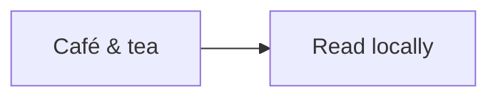

# Intentional Mermaid failure and recovery

This file deliberately contains **one invalid Mermaid block**, between two valid
ones. Expected outcome: diagrams 1 and 3 render, diagram 2 shows a local
**could not render** diagnostic, and the final Markdown remains readable. An
error here is intentional; any error in the [valid gallery](mermaid.md) is not.
Return to the [example index](README.md) for the rest of the corpus.

## Before the error: a valid diagram

Quoted Unicode and an ampersand should remain readable in both the drawing and
its **Original definition** disclosure.



## Intentional error: an unfinished node

The next definition is missing the closing `]` of its node label. Do not repair
it when using this document to check local failure handling. Its escaped original
definition should still be available even though no drawing appears.

```mermaid
flowchart LR
    Broken[This label never closes
```

## After the error: a valid duplicate

This repeats the first definition exactly. It should render independently after
the failed block, with its own controls and original definition.


## Reading continues

This paragraph and the literal code below must remain readable after the error.
The `text` fence is not an additional Mermaid diagram.

```text
One invalid diagram does not end the document.
```
