# Offline Mermaid gallery

Twelve small diagrams exercise different Mermaid grammars with the bundled
renderer. All twelve should render without a diagnostic and without fetching
external resources. Open **Original definition** on any diagram to compare its
source. See the [example index](README.md) for other reading samples and
[intentional failure and recovery](mermaid-errors.md) for the separate error case.

## Flowchart: decisions and a subgraph

A branch stays inside a local processing group. The chosen node uses a simple
fill, stroke and text color rather than document CSS.

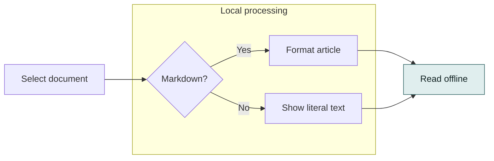

## Sequence: alternatives, a loop and a note

The two alternatives are illustrative, not a request to access any resource.

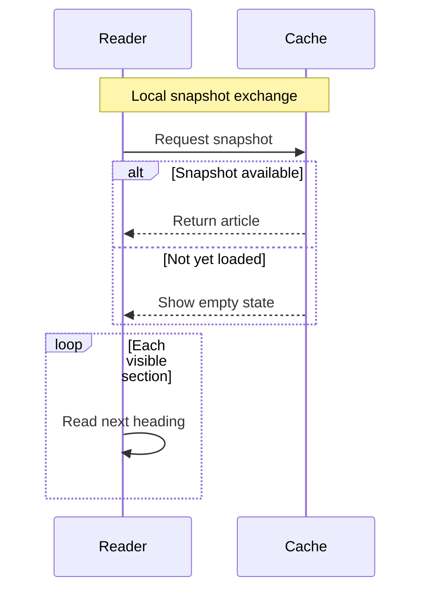

## Class: inheritance and composition

A specialized reader owns one snapshot.

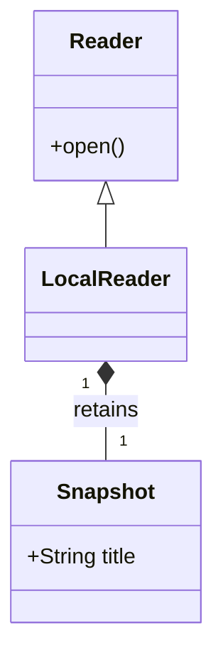

## State: a document lifecycle

A failed reload can leave the existing reading state intact.

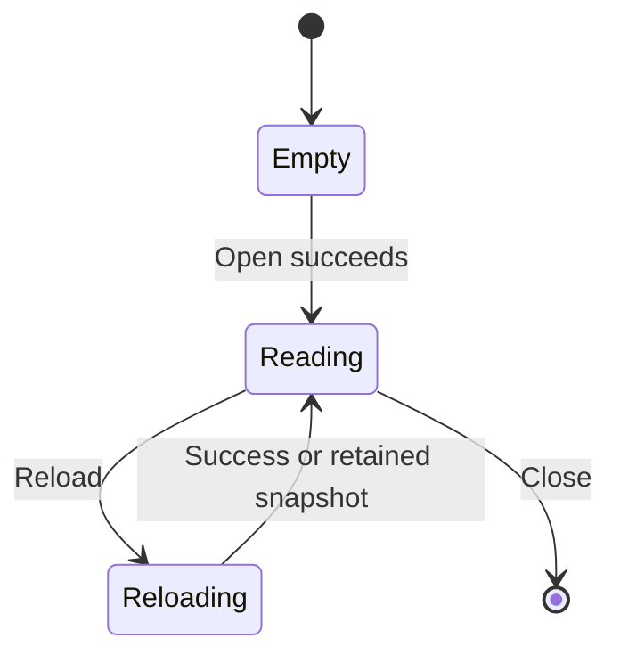

## Entity relationship: a small catalog

One collection contains many documents, each with a stable key.

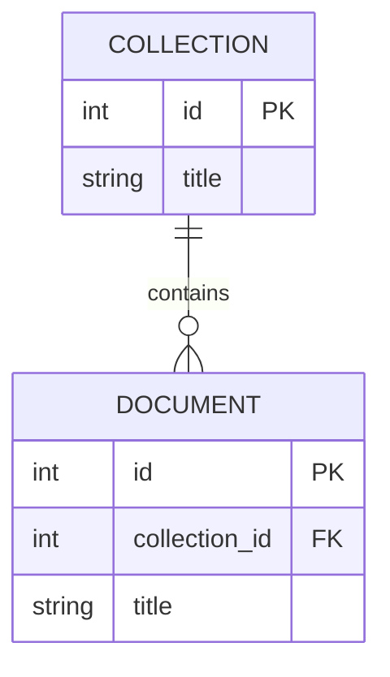

## Gantt: a fixed review schedule

Explicit historical dates keep the task bars independent of the day this file is
opened. There is no moving today marker.

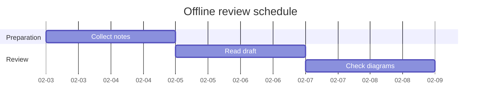

## Pie: an illustrative document mix

The values describe a fictional set of twelve local files.

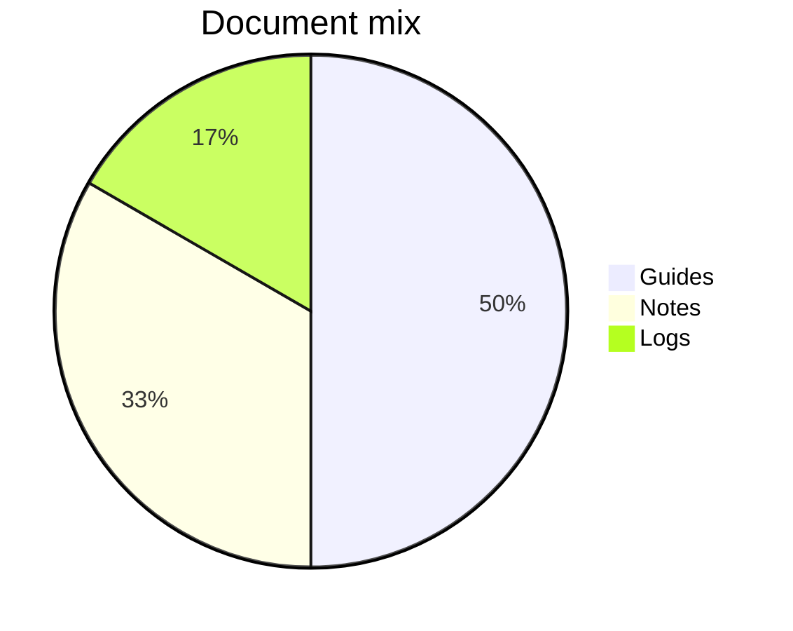

## Journey: a short reading session

Scores are illustrative satisfaction values, not elapsed time.

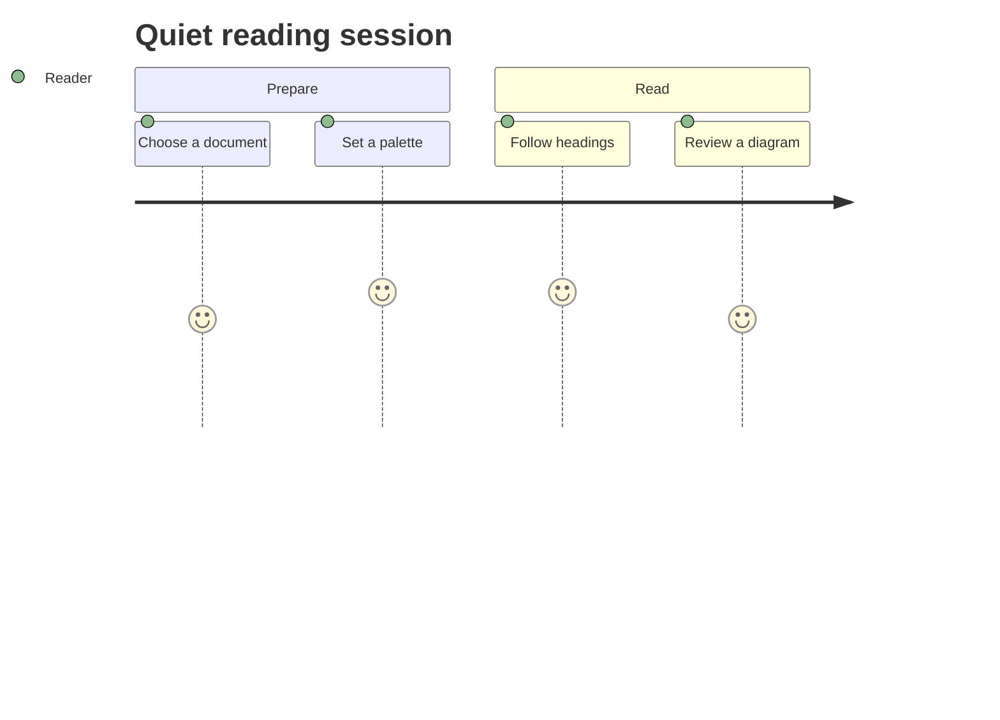

## Git graph: a branch and a merge

These are diagram-only commit labels, not commands to run.

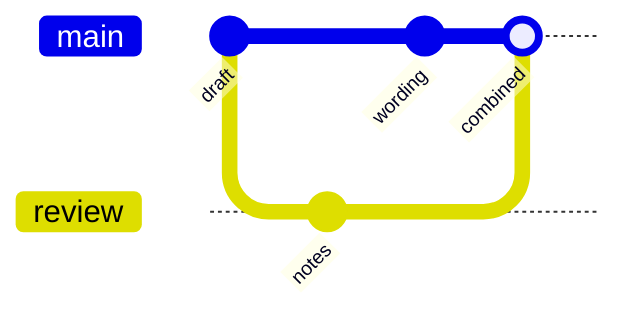

## Mind map: a reading checklist

An indented hierarchy groups content and presentation checks.

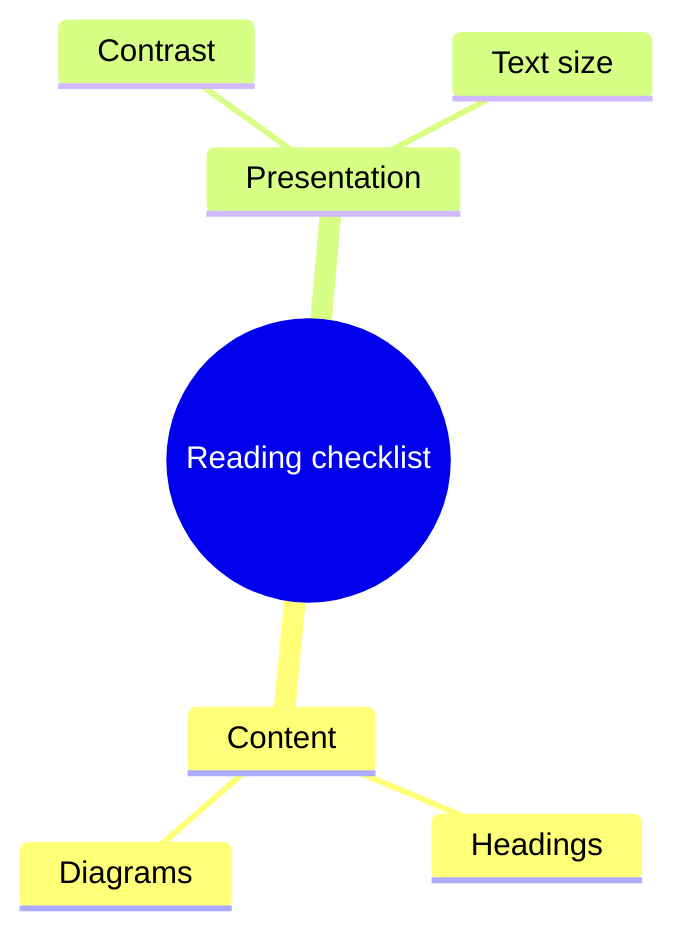

## Timeline: a fictional revision history

Fixed year labels describe stages rather than live dates.

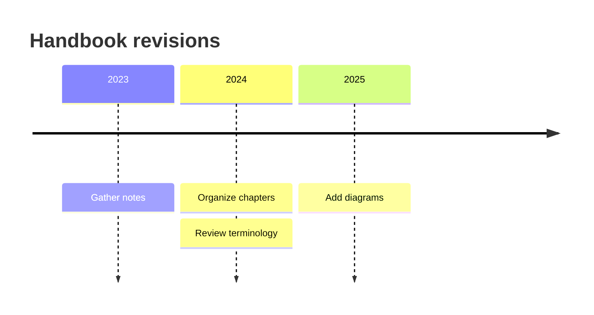

## Quadrant chart: comparing small tasks

Both coordinates are normalized values between zero and one.

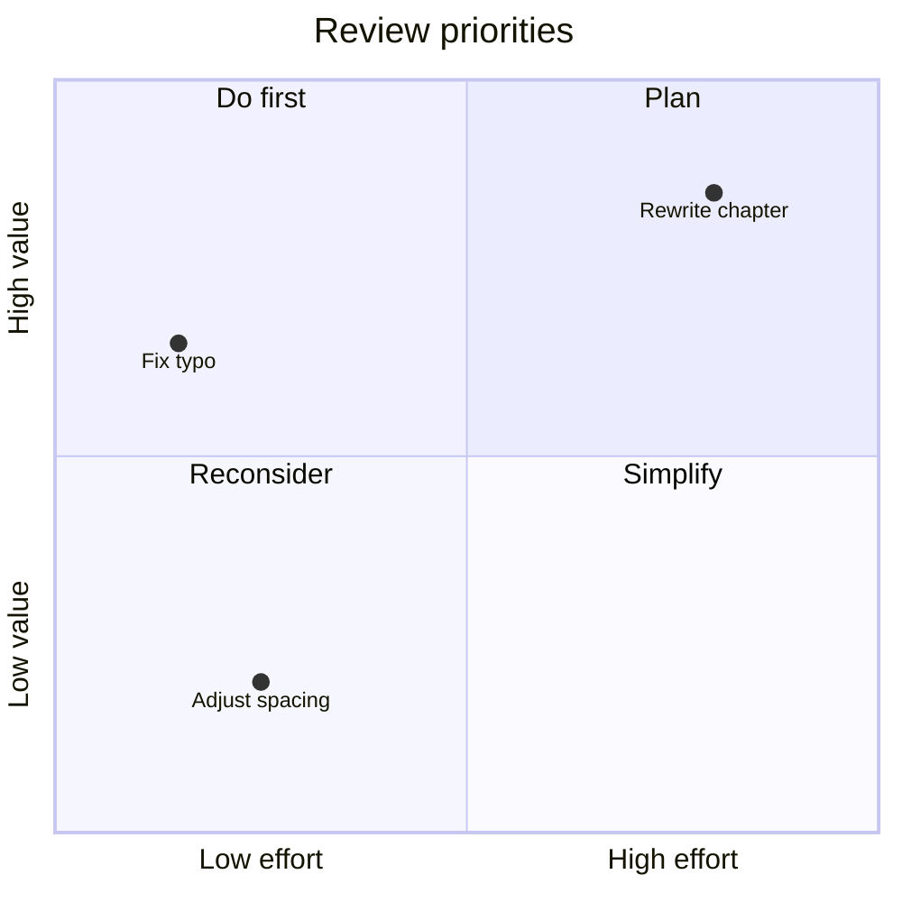

## Ordinary code remains ordinary

This fence deliberately uses `text`, so it should stay literal rather than become
a thirteenth diagram.

```text
flowchart LR
    This[Literal example] --> That[Not rendered]
```
